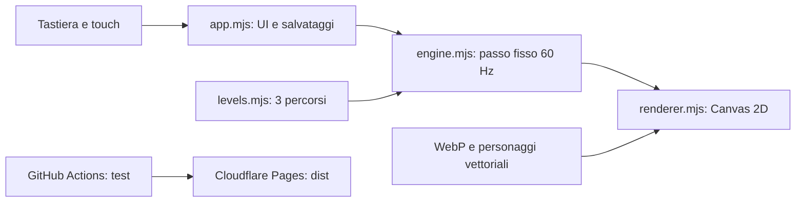

> Impostazioni e controlli condivisi: [integrazione Videogames Kit](docs/videogames-kit.md).

# Salti Magici

Platform a scorrimento per bambini, con tre livelli e due mondi selezionabili:

- **Avventura classica:** Leo, monete, funghi e castello dorato.
- **Il mondo di Elsa:** Elsa, margherite, caramelle e palazzo di ghiaccio.

Gioca: <https://saltimagici.giacomel.info> · Mirror: <https://salti-magici.pages.dev>

Progetto indipendente da Agent Pippo: repository, pubblicazione Cloudflare, salvataggi e dominio dedicati.

## Avvio e verifiche

Richiede Node.js 22 o superiore. Nessuna dipendenza di esecuzione.

```sh
npm ci
npm run build
npm test
npm run test:browser
npm run benchmark
```

Per giocare localmente, servire `dist/` con un server HTTP statico. Il test browser avvia autonomamente un server e usa Edge su Windows; altrove impostare `BROWSER_BINARY` al percorso di Chrome. `GAME_URL` permette di verificare una pubblicazione remota.

Frecce / A D: movimento; Spazio / W / freccia su: salto; Maiusc: corsa; Esc: pausa. Su telefono: pulsanti touch simultanei. Tenere premuto salto aumenta l'altezza. Colpire i blocchi dal basso attiva una protezione di 12 secondi. Ogni livello include tre stelle, checkpoint e tentativi illimitati.

Le impostazioni cambiano immediatamente lingua (IT/EN), suoni e difficoltà. Progressi separati per mondo in localStorage; nessun account o backend necessario.

## Architettura



`dist/` contiene i sorgenti browser direttamente eseguibili; `scripts/` verifica build, fisica, percorsi e browser; `vendor/` conserva la fonte MIT riutilizzata; `docs/` raccoglie decisioni e stato; `artifacts/` contiene solo risultati locali ignorati da Git.

## Pubblicazione

Ogni push a `main` esegue build, test automatici, benchmark di simulazione e verifica browser prima del deploy su **salti-magici**. Il token Cloudflare è un secret cifrato del nuovo repository, non un file. Nessun servizio a pagamento attivato.

Budget statico verificato: 1.400.000 byte. Il gioco completo pesa circa 370 KB, compresi i fondali; il dato preciso è in `docs/assets_manifest.json`.

## Fonti

Le funzioni di limite/intersezione e l'impostazione del passo fisso derivano da [Javascript Tiny-Platformer](https://github.com/jakesgordon/javascript-tiny-platformer), Jake Gordon, MIT; commit `50cbd06c410efe768b7c76f4458387a194130339`. Vedere `vendor/LICENSE.tiny_platformer`. Livelli, interfaccia, salvataggi e renderer sono specifici di questo progetto.

Fondali generati per il progetto, personaggi e oggetti disegnati e animati in Canvas. Elsa e Frozen appartengono ai rispettivi titolari; progetto fan non ufficiale. Nessun asset estratto da Super Mario Bros.

Vedere [runbook e stato](docs/resume.md) e [verifiche](docs/verification.md).
